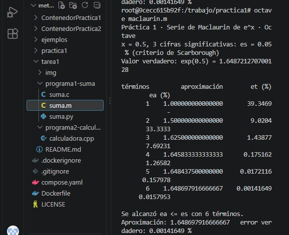
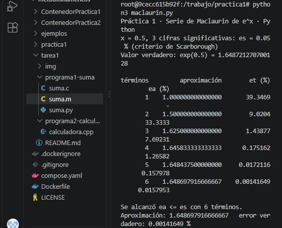
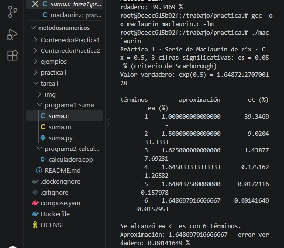

# Práctica 1 · La serie de Maclaurin y el criterio de paro

**UEA 1151039 · Métodos Numéricos en Ingeniería · Trimestre 26-O · UAM Azcapotzalco**
**Profesor:** M. en C. Gabriel Hurtado Avilés

| Integrante |Flores Gutierrez Joana |
| Matricula| 2253078289|
| Repositorio de la Tarea 1 de | Modalidad Individual |
| Fecha |12/10/2026 |

## 1. Octave y Python

En este primer procedimiento, se ejecutaron los programas macluarin.m y maclaurin.py, sin realizar ninguna modificacion, es decir, utilizando tres cifras significativas y el valor de (x=0.5)

Evidencia de Octave 



Evidencia de Python 



¿Coinciden con la lámina 25 de la unidad I? Si, los resultados de la ejecucion coidicen exactamente con la teroia y la lamina.

## 2. Las dos líneas que completamos en `maclaurin.c`

Para este segundo procedimiento, se acompletaron dos intrucciones indicadas en macluarin.c 
```c
/* COMPLETAR 1 */ termino = termino * X / n;
/* COMPLETAR 2 */ fabs((aprox - anterior) / aprox) * 100.0;
```
Para la primera modificacion, calcula cada nuevo termino de la serie a partir del anterior, por otro lado la segunda modificacion botiene el errror relativo aproximado procentual.
Finalmente se compilo y ejecuto una tabla, alcanzando el criterio de paro con seis terminos.

Evidencia de C



## 3. Más cifras significativas

En este apartado se analizó el comportamiento del algoritmo al incrementar las cifras significativas requeridas, evaluando cómo disminuye el error porcentual y cómo cambia la cantidad de términos necesarios para alcanzar la aproximación de la serie de Maclaurin. 
A continuación se presentan los resultados obtenidos:

| Cifras | εs (%) | Términos | Aproximación | Error verdadero (%) |
|---|---|---|---|---|
|3|0.5%|6|1.64869791666667|0.00141649 |
|6|5e-05|9|1.64872126503596|3.43549e-07|
|17|5e-12|16|1.648721270700128|2.69354e-14|

1. ¿Cuántos términos hacen falta en cada caso? 
Con 3 cifras se requieren 6 terminos, al aumentar la exigencia a 6 cifras se necesitan 9 terminos y para 17 cifras el programa se detiene con 16 terminos, dando a entender que si el criterio de detencion exige un mayor numero de interacciones.
2. En cada fila de la tabla, ¿εa es mayor o menor que εt? ¿Por qué conviene detenerse con εa?
El error aproximado (εa) disminuye en cada iteración hasta cumplir con la tolerancia (εs). Conviene detenerse utilizando εa (criterio de Scarborough) porque en situaciones reales el valor verdadero (εt) es desconocido; por lo tanto, el error aproximado es el único indicador práctico disponible durante el cálculo numérico para saber cuándo la solución es suficientemente confiable
3. Con 17 cifras el programa termina. ¿Cuántas cifras del resultado son correctas en realidad?
   Relaciónenlo con 0.1 + 0.2 de la Tarea 1.
Aunque se le exijan 17 cifras, las computadoras operan con el estándar IEEE 754 de doble precisión, limitando la representación exacta a unos 15 a 17 dígitos significativos. Debido a esto, los últimos decimales contienen ruido y errores de redondeo de la representación binaria, por lo que no todas las cifras impresas al extremo son totalmente exactas.

## 4. Conclusion

En esta práctica se logró implementar y comparar con éxito el cálculo numérico de la serie de Maclaurin utilizando distintos lenguajes de programación, lo que permitió comprobar la consistencia y equivalencia de los resultados matemáticos. Asimismo, se analizó el impacto del criterio de paro y el incremento de cifras significativas en la precisión y en el número de términos requeridos.

## Uso de inteligencia artificial

Google Gemini, para orientacion y resolucion en la hora de ejecutar los programas.

## Referencias

Chapra, S. C., & Canale, R. P. (0215). *Métodos Numéricos para Ingenieros*. McGraw-Hill.
Apuntes de clase de Métodos Numéricos en Ingeniería, UAM Azcapotzalco.
