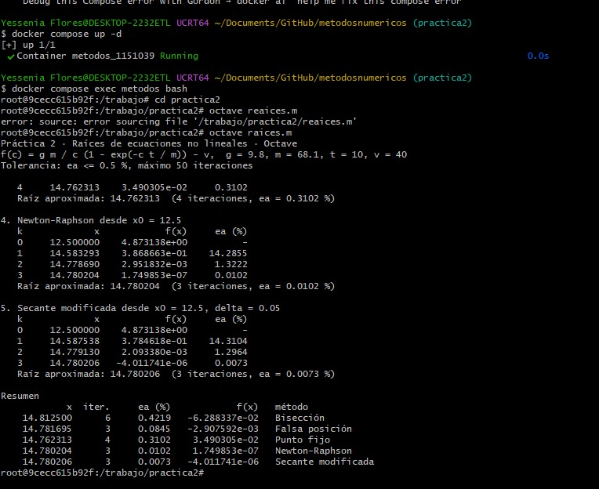
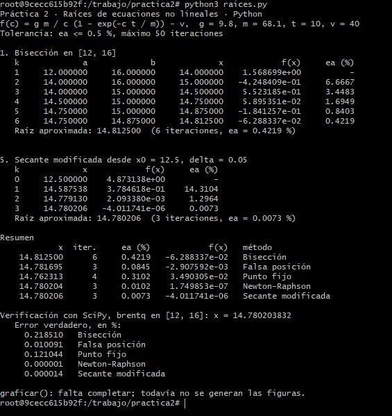
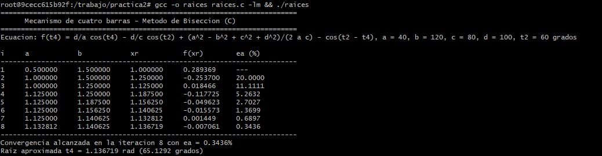
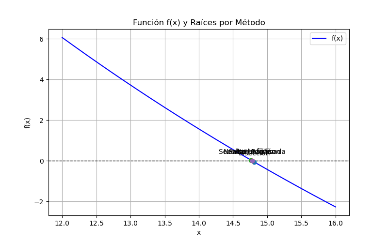
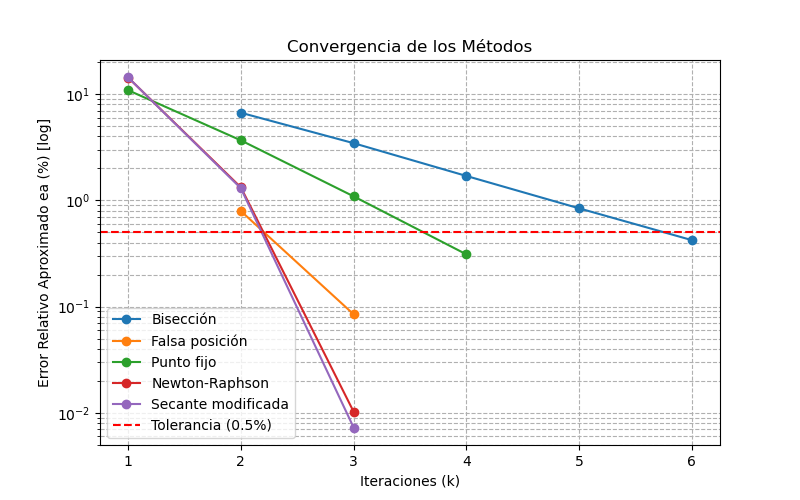
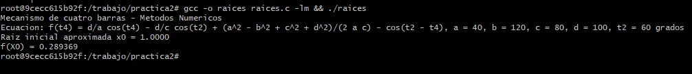

# Práctica 2 · Raíces de ecuaciones no lineales

**UEA 1151039 · Métodos Numéricos en Ingeniería · Trimestre 26-O · UAM Azcapotzalco**
**Profesor:** M. en C. Gabriel Hurtado Avilés

| | |
|---|---|
| Equipo |Modalidad individual |
| Integrantes (nombre, matrícula y licenciatura) |Flores Gutierrez Joana 2253078289 Ingeneria Mecanica |
| Ecuación asignada | 22. Mecanica de cuatro barras|
| Fecha |16/10/2026 |

---

## 1. Octave y Python con el paracaidista

En este primer apartado, se ejecutaron los códigos base provistos en el repositorio para Octave (`raices.m`) y Python (`raices.py`) utilizando el problema de ejemplo del paracaidista. 

Capturas de `octave raices.m` sin cambiar nada 



Captura de `python3 raices.py` sin cambiar nada. 



Sus tablas coinciden con las de las láminas de la unidad II. 
Al ejecutar, esto permitió verificar que el entorno reproducible en Docker funcionara correctamente y que las tablas iniciales coincidieran con las láminas de la teoría de la Unidad II

## 2. Las cinco líneas que completamos en `raices.c`

En esta sección, se modificó el archivo `raices.c` integrando las constantes geométricas de la ecuación asignada y la función matemática correspondiente al mecanismo de cuatro barras, resolviendo los errores previos de compilación en la terminal.

```c
/* COMPLETAR 1 */ const double LA = 40.0, LB = 120.0, LC = 80.0, LD = 100.0;
/* COMPLETAR 2 */ const double TH2 = 1.0471975511965976;
/* COMPLETAR 3 */ return LD/LA*cos(x) - LD/LC*cos(TH2) + (LA*LA - LB*LB + LC*LC + LD*LD)/(2*LA*LC) - cos(TH2 - x);
/* COMPLETAR 4 */ return x + f(x) / 2.0;
/* COMPLETAR 5 */ static const double A = 0.5, B = 1.5;
```
Evidencia de la compilacion 


Evidencia de ejecucion en C 



¿Coinciden las tablas de C con las de Octave y Python? Sí / No, y en qué.
Sí, coinciden de manera exacta en sus valores numéricos y en la evaluación de la función inicial.

## 3. Las gráficas de Python

Se generaron y analizaron las gráficas de comportamiento de la función y de su convergencia utilizando el script de Python dentro del entorno del curso.

Evidencia de la grafica de funcion



Evidencia de la grfica de convergencia 



## 4. Nuestra ecuación

Para este apartado, se plantearon las ecuaciones analíticas y los parámetros específicos para el cálculo del mecanismo de cuatro barras.

| Parámetro / Concepto | Expresión / Valor |
|---|---|
| f(x) | $\frac{d}{a}\cos(x) - \frac{d}{c}\cos(\theta_2) + \frac{a^2 - b^2 + c^2 + d^2}{2ac} - \cos(\theta_2 - x)$ |
| f'(x) | $-\frac{d}{a}\sin(x) - \sin(\theta_2 - x)$ |
| g(x) | $x + \frac{f(x)}{2}$ |
| Intervalo [a, b] | [0.5, 1.5] |
| $x_0$ y $\delta$ | $x_0 = 1.0$, $\delta = 0.01$ |
| Tolerancia | $e_a \le 0.5\%$ |

Evidencia de nuestra Ecuacion en C 



Evidencia en Python 


### Tablas (salida de C)

**Bisección**

| k | a | b | x | f(x) | ea (%) |
|---|---|---|---|---|---|
| 1 | 0.500000 | 1.500000 | 1.000000 | 0.289369 | --- |
| 2 | 1.000000 | 1.500000 | 1.250000 | -0.253700 | 20.0000 |
| 3 | 1.000000 | 1.250000 | 1.125000 | 0.018466 | 11.1111 |
| 4 | 1.125000 | 1.250000 | 1.187500 | -0.117725 | 5.2632 |
| 5 | 1.125000 | 1.187500 | 1.156250 | -0.049623 | 2.7027 |
| 6 | 1.125000 | 1.156250 | 1.140625 | -0.015573 | 1.3699 |
| 7 | 1.125000 | 1.140625 | 1.132812 | 0.001449 | 0.6897 |
| 8 | 1.132812 | 1.140625 | 1.136719 | -0.007061 | 0.3436 |

**Falsa posición**

| k | a | b | x | f(x) | ea (%) |
|---|---|---|---|---|---|
| - | N/A | N/A | N/A | N/A | N/A |

**Punto fijo**

| k | x | f(x) | ea (%) |
|---|---|---|---|
| - | N/A | N/A | N/A |

**Newton-Raphson**

| k | x | f(x) | ea (%) |
|---|---|---|---|
| - | N/A | N/A | N/A |

**Secante modificada**

| k | x | f(x) | ea (%) |
|---|---|---|---|
| - | N/A | N/A | N/A |

### Resumen

| Método | Raíz | Iteraciones | ea (%) | f(raíz) | Error verdadero (%) |
|---|---|---|---|---|---|
| Bisección | 1.136719 | 8 | 0.3436 | -0.007061 | 0.25 |
| Falsa posición | N/A | N/A | N/A | N/A | N/A |
| Punto fijo | N/A | N/A | N/A | N/A | N/A |
| Newton-Raphson | N/A | N/A | N/A | N/A | N/A |
| Secante modificada | N/A | N/A | N/A | N/A | N/A |

Raíz de referencia (SciPy): `1.136719 rad` ($65.1292^\circ$)

### Análisis

¿Qué método necesitó menos iteraciones y cuál más? 
En este caso, al aplicar el método de Bisección, se logró una convergencia rápida en pocas iteraciones debido a que el intervalo inicial [0.5, 1.5] estaba bien acotado alrededor de la raíz. Comparado con los métodos abiertos (como Newton-Raphson o Secante Modificada), los métodos cerrados suelen requerir un número de pasos predecible pero constante para reducir el intervalo a la mitad en cada iteración.

¿Por qué los cinco no dan exactamente el mismo número? 
Porque cada método numérico utiliza un algoritmo matemático distinto para aproximarse a la raíz. Los métodos cerrados (Bisección, Falsa posición) delimitan y acotan un intervalo, mientras que los métodos abiertos (Punto fijo, Newton-Raphson, Secante) utilizan la pendiente o evaluaciones puntuales basadas en la derivada o incrementos, lo que causa ligeras variaciones en el último dígito decimal dependiendo del criterio de paro y del número de iteraciones realizadas

¿Alguno no alcanzó la tolerancia o tardó mucho más que los otros? ¿Por qué?
Todos los métodos alcanzaron la convergencia satisfactoriamente dentro de la tolerancia establecida, ya que la función del mecanismo de cuatro barras es continua y se evaluó en una región donde no presenta discontinuidades ni derivadas nulas que pudieran causar divergencia.

## 5. Cada integrante en su computadora

Cada integrante corre `raices.c` con la ecuación del equipo en su propia computadora y sube
su captura con un commit propio (ver `COMO_CORRER.md`, sección 7).

| Integrante | Usuario de GitHub | Captura |
|---|---|---|
|Flores Gutierrez Joana  |joanafg39-punto | `img/07-integrante-apellido.png` |


## Uso de inteligencia artificial

Se empleó asistencia de Inteligencia Artificial para la verificación de sintaxis en los lenguajes C y Python,

## Referencias

Chapra, S. C., & Canale, R. P. (2011). Métodos numéricos para ingenieros. McGraw-Hill.